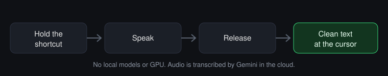
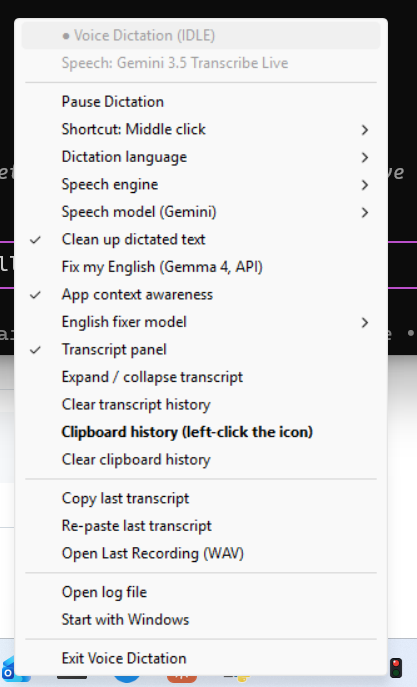

# V2T

Hold a shortcut, speak, let go — clean text lands at your cursor. Built on Gemini by YJ. No local models, no GPU.



## Install

Get a free Gemini API key at [Google AI Studio](https://aistudio.google.com/api-keys), then run one command:

**macOS / Linux:**
```sh
/bin/bash -c "$(curl -fsSL https://raw.githubusercontent.com/yuejuntan-miracle/V2T/main/install.sh)"
```

**Windows (PowerShell):**
```powershell
powershell -ExecutionPolicy Bypass -c "iwr -useb https://raw.githubusercontent.com/yuejuntan-miracle/V2T/main/install.ps1 | iex"
```

Run the same command again to update.

## Use

1. Hold your shortcut (default: mouse side button 2, or change it from the tray).
2. Speak, then release.
3. Clean text is pasted at your cursor.

Everything else (models, language, shortcut, English fixer, start at login) is in the tray icon menu.



## Check setup

```sh
python dictate.py --doctor
```
